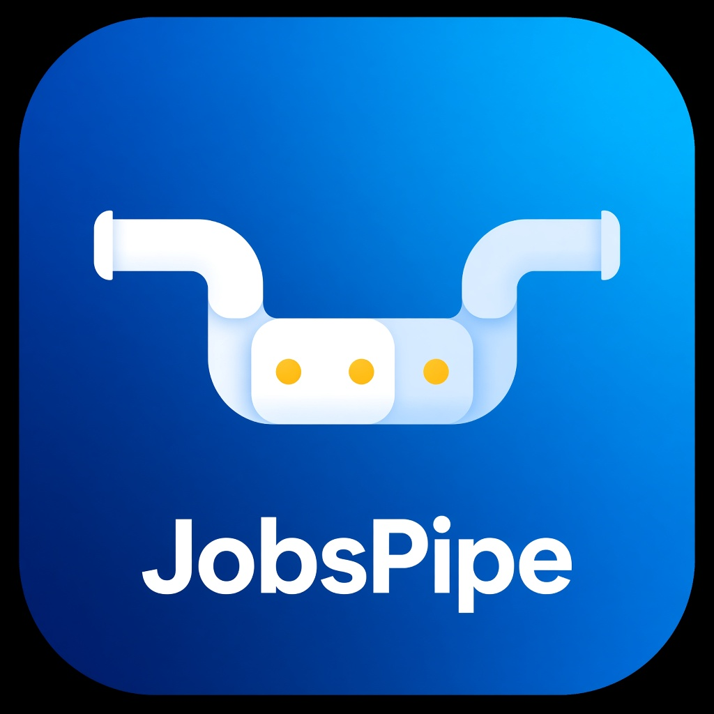

# JobsPipe Zapier Integration



A Zapier Platform CLI integration for [JobsPipe](https://jobspipe.dev) - search live job postings from 30+ job boards and ATS feeds through a single normalized API.

[](https://github.com/jobspipe/zapier-jobspipe/actions)
[](LICENSE)

## Features

### Authentication
- **API Key Authentication**: Secure Bearer token authentication with API keys from JobsPipe dashboard
- **Connection Test**: Validates API key via `/v1/account` endpoint
- **Smart Connection Label**: Shows authenticated user's email and plan name

### Triggers
- **New Job Matching Search**: Polling trigger that monitors for new job postings matching your search criteria
  - Deduplicates jobs by stable job ID
  - Supports keyword, location, remote, company domain, and country filters
  - Returns jobs from the last 30 days

### Searches
- **Find Jobs**: Search for job postings with advanced filters
  - Filter by job title keywords, location, remote status, company domain, country, seniority, and job age
  - Configurable result limit (default: 25, max: 100)
  - Returns normalized job data from 30+ sources

- **Find Company**: Look up company profiles by domain, name, or email
  - Returns enriched company data including employee count, location, LinkedIn, and founding year
  - Suggests similar companies when exact match not found

## Installation & Setup

### Prerequisites
- Node.js 22 or higher (required by zapier-platform-cli 19.3.0)
- npm or yarn
- Zapier Platform CLI (`npm install -g zapier-platform-cli`)

### Local Development

1. **Clone the repository**
   ```bash
   git clone https://github.com/jobspipe/zapier-jobspipe.git
   cd zapier-jobspipe
   ```

2. **Install dependencies**
   ```bash
   npm install
   ```

3. **Run tests**
   ```bash
   npm test
   ```

4. **Validate the integration**
   ```bash
   npm run validate
   ```

### Testing with Zapier CLI

1. **Link to Zapier account**
   ```bash
   zapier login
   ```

2. **Register the integration (first time only)**
   ```bash
   zapier register "JobsPipe"
   ```

3. **Push to Zapier**
   ```bash
   zapier push
   ```

4. **Test in Zapier editor**
   - Go to https://zapier.com/app/developer
   - Open your integration
   - Click "Test Integration" to try triggers and searches

### Environment Setup

To test authentication locally:

```bash
export JOBSPIPE_API_KEY=jp_live_your_key_here
zapier test --debug
```

Get your API key at [jobspipe.dev/dashboard](https://jobspipe.dev/dashboard).

## Project Structure

```
.
├── index.js                 # Main app definition
├── authentication.js        # API key authentication
├── triggers/
│   └── newJob.js           # New Job Matching Search trigger
├── searches/
│   ├── findJobs.js         # Find Jobs search
│   └── findCompany.js      # Find Company search
├── test/
│   ├── authentication.test.js
│   ├── triggers/
│   │   └── newJob.test.js
│   └── searches/
│       ├── findJobs.test.js
│       └── findCompany.test.js
└── .github/workflows/
    └── ci.yml              # GitHub Actions CI/CD
```

## API Reference

### JobsPipe API
- **Base URL**: `https://api.jobspipe.dev`
- **Documentation**: https://docs.jobspipe.dev
- **OpenAPI Spec**: https://jobspipe.dev/openapi.json

### Endpoints Used
- `GET /v1/account` - Authentication test
- `POST /v1/jobs/search` - Job search (triggers & searches)
- `GET /v1/companies/{key}` - Company lookup

## Testing

The integration includes comprehensive unit tests using Jest and nock for HTTP mocking:

```bash
# Run all tests
npm test

# Run tests with coverage
npm test -- --coverage

# Run specific test file
npm test -- test/triggers/newJob.test.js
```

All tests mock HTTP requests to avoid consuming API credits during testing.

## Deployment

### Push to Zapier Platform

```bash
# Push the latest version
zapier push

# Promote to a specific environment
zapier promote 1.0.0  # Promotes version 1.0.0
```

### Version Management

```bash
# List all versions
zapier versions

# Deprecate an old version
zapier deprecate 1.0.0 2026-12-31
```

### Publishing to Zapier App Directory

After pushing and testing:

```bash
# Request to make your integration public
zapier promote [version]
```

Then submit for review via the [Zapier Developer Platform](https://zapier.com/app/developer).

## Zapier Public App Checklist

Before submitting for public review, ensure:

### Required
- [x] **App Description**: Clear description of JobsPipe's functionality
- [x] **Category**: Recruiting/HR (primary), Sales CRM (secondary)
- [x] **Logo**: High-quality app icon at `logo.png` (1024x1024 PNG/JPEG)
- [x] **Authentication**: API key auth with connection test
- [x] **Triggers**: At least one trigger (New Job Matching Search)
- [x] **Searches**: At least two searches (Find Jobs, Find Company)
- [x] **Tests**: Comprehensive unit tests with >80% coverage
- [x] **Validation**: `zapier validate` passes
- [x] **Documentation**: Complete README with setup instructions
- [x] **Error Handling**: Proper error messages and HTTP status code handling
- [x] **Sample Data**: Realistic sample data for all operations
- [x] **Field Labels**: Descriptive labels and help text for all input/output fields

### Recommended
- [x] **CI/CD**: GitHub Actions workflow for automated testing
- [x] **Deduplication**: Triggers deduplicate by stable job ID
- [ ] **Pagination**: Future enhancement for large result sets
- [x] **Rate Limiting**: Handled by Zapier platform and JobsPipe API
- [ ] **Webhooks**: Future enhancement (JobsPipe supports webhooks for job.closed events)

### Before Submission
1. ✅ **Add App Logo**: Logo available at `logo.png` - upload to Zapier platform during submission
2. **Test Thoroughly**: Create several test Zaps using each trigger and search
3. **Review API Usage**: Ensure API calls are efficient and respect rate limits
4. **Update App Description**: Finalize the public-facing description on Zapier platform
5. **Set Categories**: 
   - Primary: **Recruiting / HR**
   - Secondary: **Sales & CRM** (for sales teams using hiring signals)

### Submission Commands

```bash
# 1. Ensure tests pass
npm test

# 2. Validate the integration
npm run validate

# 3. Push to Zapier
zapier push

# 4. Test in Zapier UI (create test Zaps)
# Visit: https://zapier.com/app/developer

# 5. Promote version for review
zapier promote [version]

# 6. Submit for public review via Zapier Developer Platform
# Visit: https://zapier.com/app/developer/[your-app-id]/versions
```

## Contributing

Contributions are welcome! Please:

1. Fork the repository
2. Create a feature branch (`git checkout -b feature/amazing-feature`)
3. Make your changes
4. Add/update tests
5. Ensure tests pass (`npm test`)
6. Ensure validation passes (`npm run validate`)
7. Commit your changes (`git commit -m 'Add amazing feature'`)
8. Push to the branch (`git push origin feature/amazing-feature`)
9. Open a Pull Request

## Support

- **JobsPipe Docs**: https://docs.jobspipe.dev
- **Zapier Platform Docs**: https://platform.zapier.com/
- **Issues**: https://github.com/jobspipe/zapier-jobspipe/issues
- **Email**: support@jobspipe.dev

## License

This project is licensed under the MIT License - see the [LICENSE](LICENSE) file for details.

## Acknowledgments

- Built with [Zapier Platform CLI](https://github.com/zapier/zapier-platform)
- Powered by [JobsPipe API](https://jobspipe.dev)
- Reference implementations: [n8n-nodes-jobspipe](https://github.com/jobspipe/n8n-nodes-jobspipe) and [activepieces-piece-jobspipe](https://github.com/jobspipe/activepieces-piece-jobspipe)
